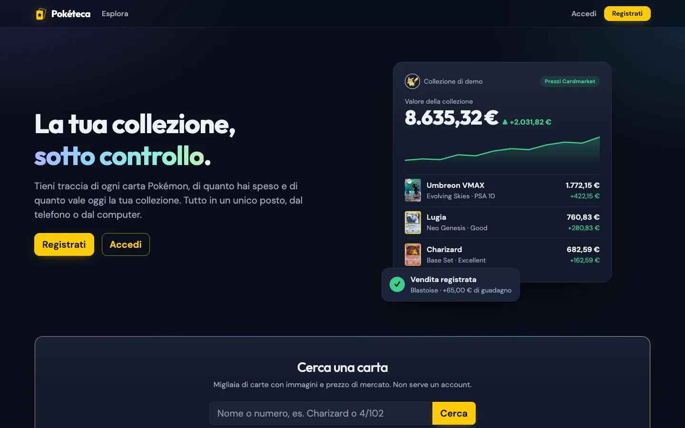
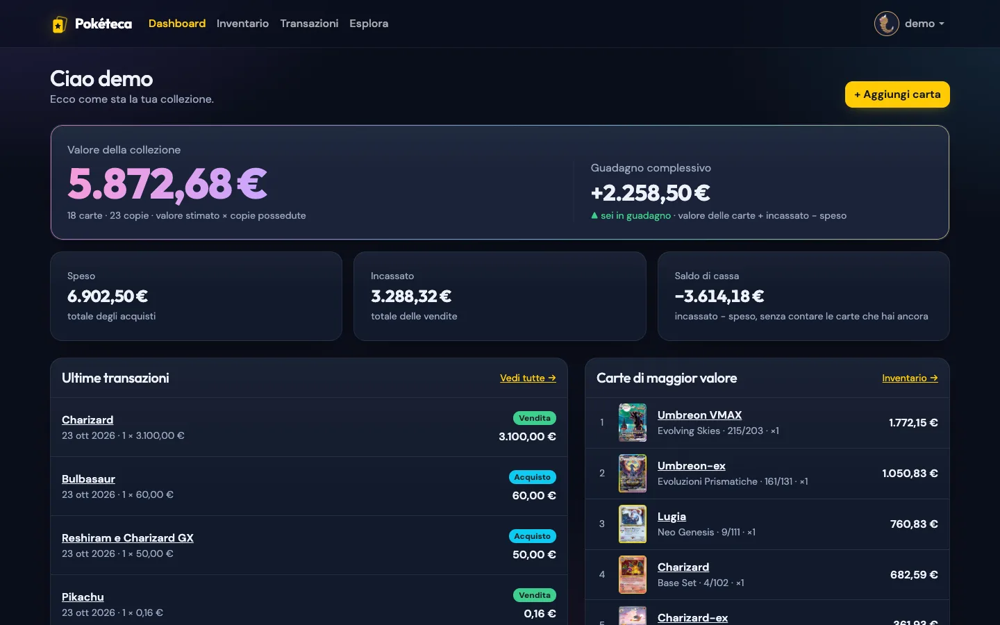
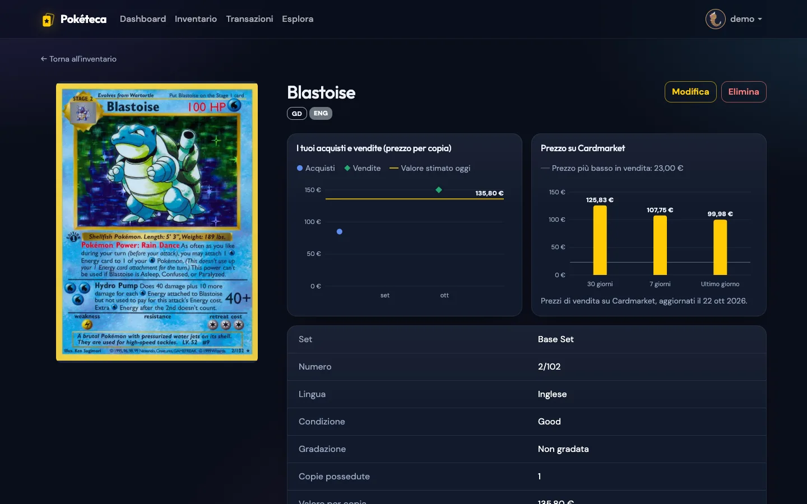
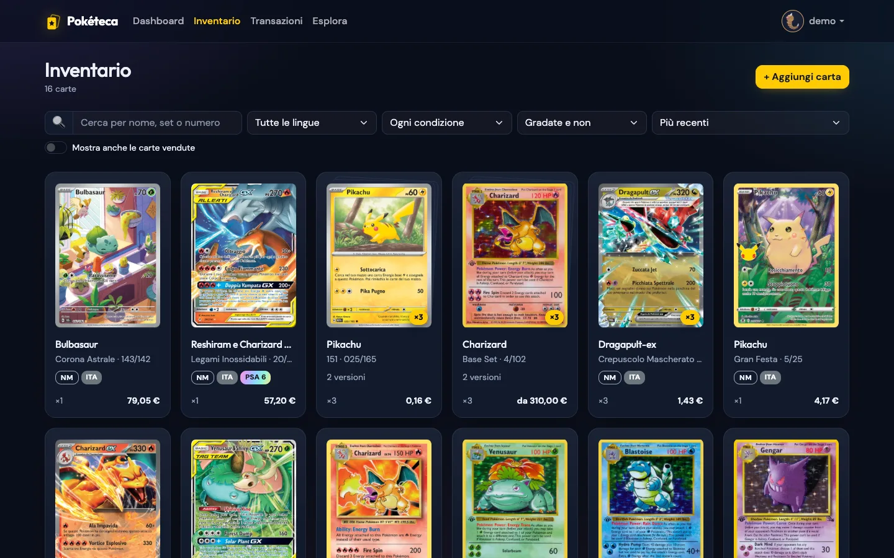
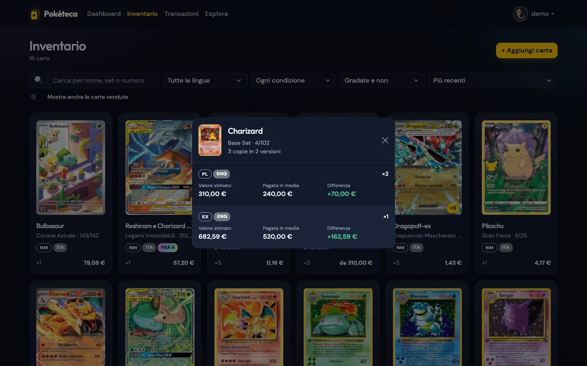
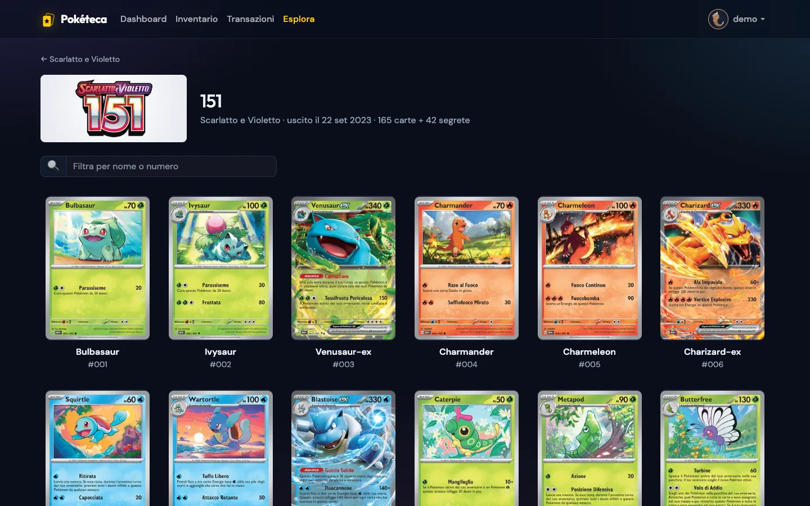
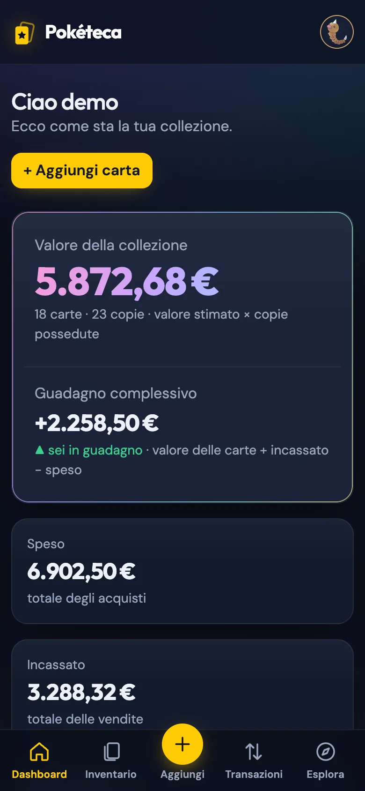
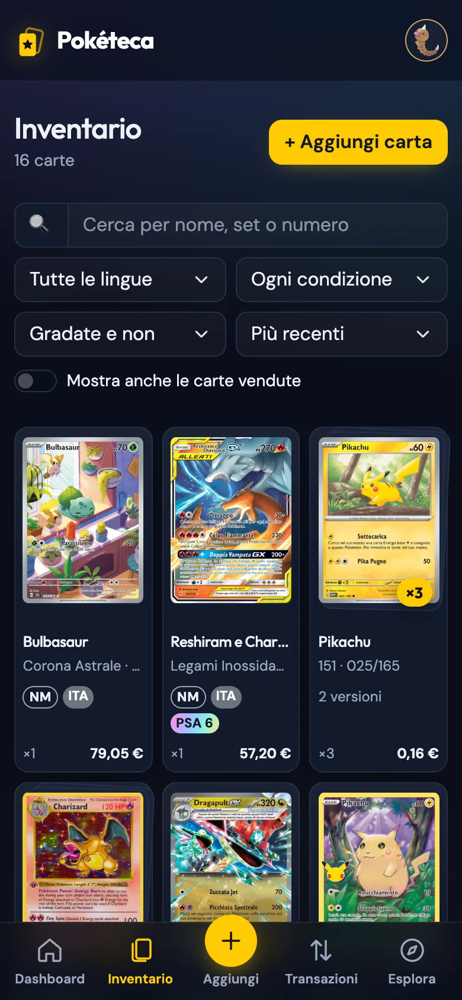

# Pokéteca

**Gestionale per collezionisti di carte Pokémon**: inventario delle carte, acquisti e vendite, valore della collezione con i prezzi di Cardmarket e un catalogo pubblico di tutte le espansioni.

Capstone project del corso Full Stack Developer di Epicode. Backend in **Java / Spring Boot**, frontend in **React**.

**Sito online: [poketeca-fe.onrender.com](https://poketeca-fe.onrender.com)**

Per provarlo senza registrarsi c'è un account demo con una collezione già pronta:

| Email | Password |
| --- | --- |
| `demo@poketeca.it` | `demo1234` |

> Il sito usa il piano gratuito di Render: dopo 15 minuti senza visite il backend va in pausa, e la prima richiesta può impiegare circa un minuto a risvegliarlo. Dopo, l'app risponde normalmente.



## Funzionalità

- **Account**: registrazione e login con JWT. Ogni utente vede e modifica solo le proprie carte. Avatar a scelta tra i 1025 Pokémon, con un bordo del colore del Pokémon.
- **Inventario**: ogni carta con set, numero, lingua, condizione (da Mint a Poor), gradazione (PSA, BGS, CGC...), copie e valore stimato. Ricerca, filtri, ordinamento e paginazione. Le copie della stessa carta in versioni diverse sono raggruppate, con una finestra di confronto: condizione, valore, prezzo pagato in media e differenza.
- **Aggiunta guidata**: si cerca la carta per nome o per numero stampato (`Charizard`, `4/102`, `Charizard 4/102`). Nome, set, immagine e prezzo di mercato si compilano da soli, e l'acquisto viene registrato insieme alla carta. Si può caricare anche una foto propria, per esempio della carta gradata.
- **Acquisti e vendite**: ogni movimento aggiorna le copie possedute. Uno storico filtrabile per tipo e periodo, e ogni movimento si può annullare.
- **Dashboard**: valore della collezione, guadagno complessivo, speso, incassato, ultime transazioni e carte di maggior valore.
- **Grafici**: nella pagina di ogni carta, gli acquisti e le vendite nel tempo confrontati con il valore attuale, e le medie del prezzo su Cardmarket.
- **Catalogo pubblico (Esplora)**: tutte le serie e i set con le loro carte, in 7 lingue, consultabili anche senza account. Le carte giapponesi si cercano e si leggono in caratteri latini (`pikachu` trova ピカチュウ).
- **Pensata anche per il telefono**: layout responsive e barra di navigazione in basso.

| Dashboard | Pagina della carta con i grafici |
| --- | --- |
|  |  |

| Inventario | Confronto tra le versioni di una carta |
| --- | --- |
|  |  |

| Catalogo di un set | Telefono |
| --- | --- |
|  |   |

## Tecnologie

**Backend**
- Java 25, Spring Boot 4.1 (Web MVC, Data JPA, Validation)
- Spring Security con OAuth2 Resource Server: JWT firmati HS256, password cifrate con BCrypt
- PostgreSQL con Hibernate, ricerche dinamiche con le JPA Specification
- Cloudinary per le foto caricate dagli utenti
- [TCGdex](https://tcgdex.dev) per catalogo, immagini e prezzi Cardmarket delle carte
- JUnit 5, Mockito e MockMvc per i test

**Frontend**
- React 19 con Vite
- Redux Toolkit per sessione e inventario, React Router per le pagine
- React Bootstrap con un tema scuro personalizzato (font Outfit e DM Sans)
- Grafici in SVG, senza librerie esterne

**Deploy**
- Render: database PostgreSQL, backend in un container Docker e frontend come sito statico, configurati insieme in [`render.yaml`](render.yaml)

## Struttura del progetto

```
capstone/
├── backend/                  API REST Spring Boot
│   ├── src/main/java/kian/backend/
│   │   ├── controllers/      endpoint REST
│   │   ├── services/         logica (carte, transazioni, dashboard, catalogo TCGdex, upload)
│   │   ├── repositories/     accesso al database (Spring Data JPA)
│   │   ├── entities/         tabelle: utenti, carte, transazioni
│   │   ├── payloads/         DTO di richieste e risposte (record)
│   │   ├── security/         configurazione Spring Security e JWT
│   │   ├── exceptions/       errori e gestore globale
│   │   └── config/           account demo
│   ├── src/test/java/        test
│   └── Dockerfile
├── frontend/                 applicazione React
│   └── src/
│       ├── pages/            pagine (dashboard, inventario, carta, catalogo...)
│       ├── components/       componenti riutilizzabili (carte, grafici, modali...)
│       ├── store/            Redux Toolkit
│       └── lib/              chiamate al backend e formattazione
├── postman/                  collection Postman con tutte le richieste
└── render.yaml               deploy su Render
```

## Avvio in locale

### Requisiti

- **Java 25** (Maven non serve: c'è il wrapper `./mvnw`)
- **Node.js 20.19 o più recente** (consigliato 22)
- **PostgreSQL** in esecuzione, con un database vuoto. Le tabelle le crea il backend al primo avvio.

### 1. Clona il repository

```bash
git clone https://github.com/Kianetor/capstone.git
cd capstone
```

### 2. Database

```bash
createdb poketeca
```

oppure, da `psql`: `CREATE DATABASE poketeca;`

### 3. Backend

```bash
cd backend
cp .env.example .env
```

Apri `.env` e compila almeno:

| Variabile | Cosa mettere |
| --- | --- |
| `DB_URL` | `jdbc:postgresql://localhost:5432/poketeca` (cambia porta o nome se diversi) |
| `DB_USERNAME` / `DB_PASSWORD` | le credenziali del tuo PostgreSQL |
| `JWT_SECRET` | una stringa casuale di almeno 32 caratteri, ad esempio l'output di `openssl rand -base64 48` |
| `CLOUDINARY_*` | facoltative: servono solo per caricare le foto ([console.cloudinary.com](https://console.cloudinary.com) → API Keys) |

Poi avvia il server:

```bash
./mvnw spring-boot:run
```

Il backend risponde su `http://localhost:8080` (prova `http://localhost:8080/api/health`).

**Account demo in locale (facoltativo).** Avviando una volta con `DEMO_ENABLED=true` viene creato l'account `demo@poketeca.it` / `demo1234` con la collezione di esempio:

```bash
DEMO_ENABLED=true ./mvnw spring-boot:run
```

### 4. Frontend

In un secondo terminale, dalla cartella principale del progetto:

```bash
cd frontend
npm install
npm run dev
```

Apri `http://localhost:5173`. In sviluppo non serve configurare niente: Vite inoltra le chiamate `/api` al backend sulla porta 8080.

Per provarlo dal telefono sulla stessa rete Wi-Fi: `npm run dev -- --host` e apri l'indirizzo "Network" che compare nel terminale.

## Test

Il backend ha 34 test: logica di carte e transazioni, utenti, sicurezza delle API, errori, upload e nomi delle carte giapponesi. Non serve il database, girano anche appena clonato il progetto:

```bash
cd backend
./mvnw test
```

Per il frontend: `npm run lint` (oxlint) controlla il codice.

## API

Tutte le risposte sono in JSON. Gli errori hanno sempre la forma `{ "status": 404, "message": "..." }`, oppure, per i dati non validi, `{ "status": 400, "errors": { "campo": "motivo" } }`. Le richieste protette vogliono l'intestazione `Authorization: Bearer <token>`.

Nella cartella [`postman/`](postman) c'è la collection con tutte le richieste pronte. Dopo il login il token viene salvato da solo.

| Metodo | Percorso | Descrizione | Accesso |
| --- | --- | --- | --- |
| `POST` | `/api/auth/register` | registrazione | pubblico |
| `POST` | `/api/auth/login` | login, restituisce il JWT | pubblico |
| `GET` | `/api/users/me` | utente collegato | token |
| `PATCH` | `/api/users/me/avatar` | cambia l'avatar | token |
| `GET` | `/api/pokemon` | elenco dei Pokémon per l'avatar | token |
| `GET` | `/api/cards` | carte con filtri, ordinamento e pagine | token |
| `GET` | `/api/cards/groups` | come sopra, con le copie della stessa carta raggruppate | token |
| `GET` | `/api/cards/{id}` | dettaglio di una carta con il suo storico | token |
| `POST` | `/api/cards` | aggiungi una carta (con l'acquisto, facoltativo) | token |
| `PUT` | `/api/cards/{id}` | modifica una carta | token |
| `DELETE` | `/api/cards/{id}` | elimina una carta e le sue transazioni | token |
| `POST` | `/api/cards/{id}/image` | carica una foto (multipart, campo `file`, max 5 MB) | token |
| `POST` | `/api/cards/{id}/transactions` | registra un acquisto o una vendita | token |
| `GET` | `/api/transactions` | storico con filtri per tipo e periodo (`type`, `from`, `to`) | token |
| `DELETE` | `/api/transactions/{id}` | annulla una transazione | token |
| `GET` | `/api/dashboard/stats` | numeri della dashboard | token |
| `GET` | `/api/external/cards/search` | cerca nel catalogo (`q`, `lang`, `page`) | pubblico |
| `GET` | `/api/external/cards/{id}` | carta del catalogo con prezzi Cardmarket | pubblico |
| `GET` | `/api/external/series` | serie del catalogo | pubblico |
| `GET` | `/api/external/series/{id}` | set di una serie | pubblico |
| `GET` | `/api/external/sets/latest` | ultime espansioni uscite | pubblico |
| `GET` | `/api/external/sets/{id}` | carte di un set | pubblico |
| `GET` | `/api/health` | stato del server | pubblico |

## Deploy su Render

Il file [`render.yaml`](render.yaml) descrive database, backend e frontend. Su Render: **New → Blueprint**, scegli il repository e compila le variabili richieste:

- `CORS_ALLOWED_ORIGINS`: l'indirizzo del frontend, ad esempio `https://poketeca-fe.onrender.com`
- `VITE_API_URL`: l'indirizzo del backend, ad esempio `https://poketeca-be.onrender.com`
- `CLOUDINARY_*`: facoltative, per le foto

`JWT_SECRET` lo genera Render, e il database viene collegato da solo. In produzione l'account demo si crea al primo avvio.

## Crediti

- Dati, immagini e prezzi delle carte: [TCGdex](https://tcgdex.dev), con prezzi da Cardmarket
- Artwork e nomi dei Pokémon: [PokéAPI](https://pokeapi.co)

Pokémon e i nomi dei personaggi sono marchi di Nintendo, Creatures Inc. e GAME FREAK inc. Questo è un progetto didattico, senza scopo di lucro e non affiliato.

## Autore

**Kian Leonardo Jozdani**: [github.com/Kianetor](https://github.com/Kianetor)
